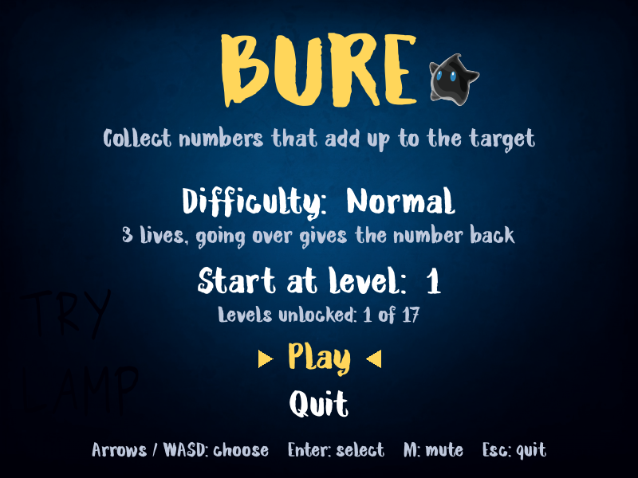
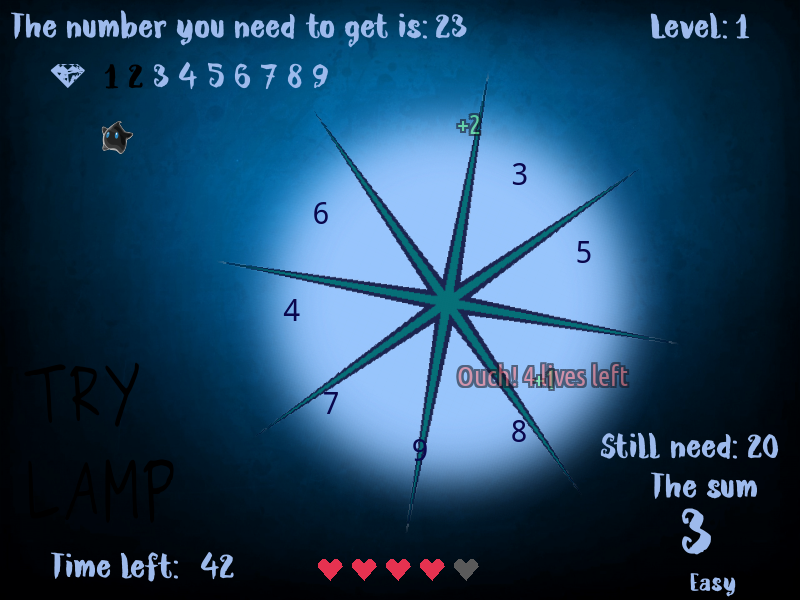
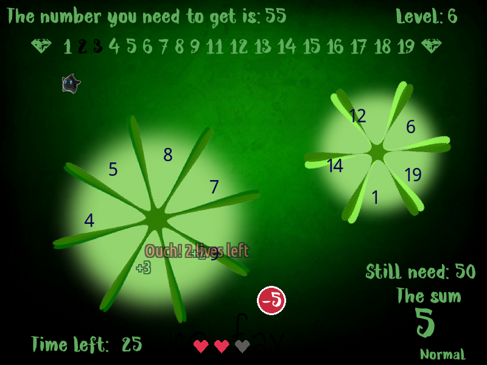
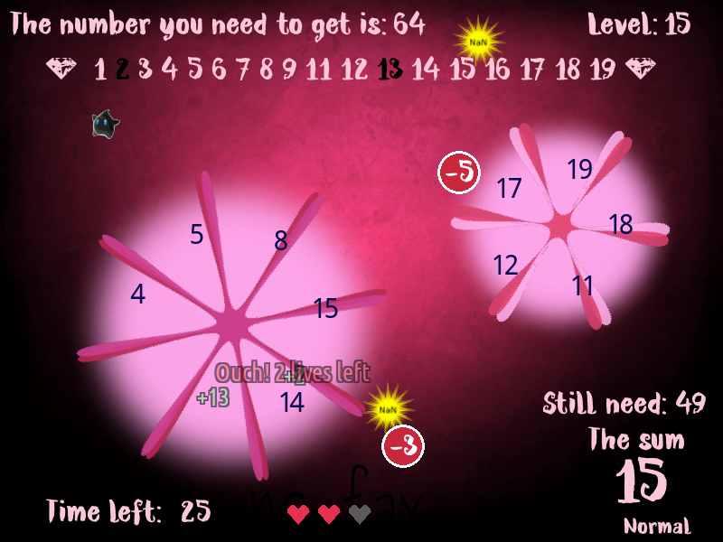

# BURE

A small arcade math game written in Python with [pygame](https://www.pygame.org/).

Steer the penguin around the screen and pick up the numbers orbiting the
spinning stars. Their total has to match the target number **exactly**. Dodge
the stars and the bouncing hazards, and beat the clock.




## Quick start

You need Python 3.9 or newer.

```bash
git clone https://github.com/Tetrix/bure.git
cd bure
python -m venv .venv
source .venv/bin/activate        # Windows: .venv\Scripts\activate
pip install -r requirements.txt
python -m bure
```

Or install it as a command:

```bash
pip install .
bure
```

### Options

```bash
python -m bure                        # opens the title screen
python -m bure --level 10             # skip the menu and start on level 10 (1-17)
python -m bure --difficulty easy      # easy, normal or classic
python -m bure --seed 42              # get the same target numbers every run
```

## How to play

| Key                  | Action                                            |
| -------------------- | ------------------------------------------------- |
| Arrow keys / W A S D | Move the penguin (and choose options in the menu) |
| Backspace / U        | Undo: give back the last number (costs 2 s)       |
| P                    | Pause / resume                                    |
| M                    | Mute / unmute sound                               |
| Esc                  | Back to the menu (quit from the menu)             |
| Enter / Space        | Select in the menu                                |

* The target number is at the top left. The row of numbers below it shows
  which values are in play. A number you've collected turns black.
* **Still need** shows how much is left to reach the target, and your total is
  under **The sum**.
* Hit the target exactly to move on. Beating a level unlocks it on the title
  screen, so next time you can start from there.
* Going over the target gives the number back, with a "Too much!" message
  (except in Classic).
* Touching a star or a hazard costs a heart. You keep your numbers and blink
  for a moment, so you can't lose two hearts at once. Out of hearts, or out of
  time, and the level restarts with a new target.
* From level 6 on, red **minus bubbles** (−1 to −5) drift around the screen.
  Grab one to lower your total when you're stuck.

### Difficulty

Pick it on the title screen or with `--difficulty`.

| Mode    | Hearts | Time          | Speed      | Extras |
| ------- | ------ | ------------- | ---------- | ------ |
| Easy    | 5      | 40% more      | 25% slower | Hints (the number that finishes the target glows, numbers that would overshoot fade), softer star hitboxes, plus everything in Normal |
| Normal  | 3      | as listed     | normal     | Going over gives the number back, undo, minus bubbles |
| Classic | 1      | 40% of listed | normal     | The original 2015 rules: going over or one touch restarts the level, no undo, no minus bubbles |

### Levels

| Levels | What's on screen                                   | Numbers | Time (Normal) |
| ------ | -------------------------------------------------- | ------- | ---------- |
| 1–5    | One wheel and one star                             | 1–9     | 30 s (levels 1–2), then 25 s |
| 6–9    | Two wheels with a star each, numbers on two rings  | 1–19    | 25 s |
| 10–14  | Same as 6–9, plus a bouncing hazard                | 1–19    | 25 s |
| 15–17  | New colour theme and two bouncing hazards          | 1–19    | 25 s |

Targets get bigger and things spin faster as you go.

Progress (unlocked levels and the last difficulty) is saved to
`~/.local/share/bure/progress.json` on Linux and macOS, or
`%APPDATA%\bure\progress.json` on Windows. Delete the file to start over.




## Project layout

```
bure/
├── __main__.py   # command-line entry point (python -m bure)
├── game.py       # main loop and scene flow: menu -> levels -> victory
├── session.py    # the rules: one attempt at one level (lives, overshoot, undo)
├── levels.py     # all 17 levels described as data
├── difficulty.py # Easy / Normal / Classic settings
├── entities.py   # Player, Spinner, Ring of numbers, MinusBubble, Hazard
├── hud.py        # on-screen text, timer and hearts
├── menu.py       # title screen
├── effects.py    # floating text and screen shake
├── audio.py      # synthesized sound effects (no sound files needed)
├── progress.py   # save file for unlocked levels
├── assets.py     # cached image and font loading
├── settings.py   # screen size, FPS and other constants
└── resources/    # images and fonts
tests/            # pytest suite (runs headless)
```

### Adding or changing a level

Levels live in `bure/levels.py` as `LevelSpec` entries in the `LEVELS` tuple.
`_single(...)` builds a one-wheel level and `_double(...)` builds a two-wheel
level. Each takes the target range, spin speeds, which numbers sit on each
ring, how fast the rings orbit, and any hazards. You don't need to touch the
game code.

## Running the tests

```bash
pip install pytest
pytest
```

The tests run without opening a window, using SDL's dummy video driver. They
check that:

* every level's target range can actually be reached with that level's numbers
* every asset a level uses exists
* winning, going over the target (number given back, or a loss in Classic),
  undo, losing a heart, losing the last heart and running out of time all work
* minus bubbles appear on the right levels and lower the sum
* beating a level unlocks the next one and saves it
* every level starts and runs on every difficulty without errors

## History

BURE was written in 2015 by Dejan Porjazovski
([@Tetrix](https://github.com/Tetrix)) and
[@shakle17](https://github.com/shakle17) as a Python 2 learning project. In
2026 it was rewritten for Python 3 and pygame 2. The level layouts are the
same. Classic mode keeps the original rules, and Easy and Normal make the game
friendlier. The code is structured differently:

* the 4,000+ line `game.py` with 17 copy-pasted level functions became one
  game loop driven by level data
* moving to a new level no longer calls the next level function from inside
  the current one, so the call stack doesn't grow with every retry and can't
  end in a recursion error
* star images are no longer reloaded from disk every frame, text is rendered
  once instead of every frame, and pixel masks are only built when the penguin
  is close enough to touch something
* movement, timers and rotation use real elapsed time, so the game plays the
  same at any frame rate
* the dependency on the old `gameobjects` library is gone (it now uses
  `pygame.Vector2`)
* fixed bugs from the original:
  * level 7 counted the 17 and the 13 as 19 and 3
  * some numbers on screen couldn't be collected (for example the 18 on
    level 17)
  * level 15–17 stars were drawn inside solid black boxes, and touching the box
    killed you
  * the game started on level 17 because of a leftover debug call
* new in 2026: title screen with level unlocks, difficulty modes, hearts,
  undo, hints, minus bubbles, sound effects, floating score text and screen
  shake

## License

No license has been chosen yet. Until one is added, all rights are reserved by
the original authors.
